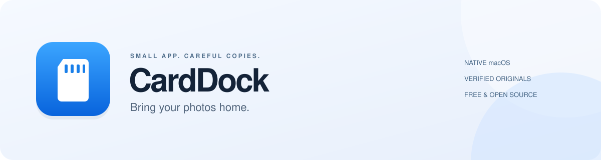
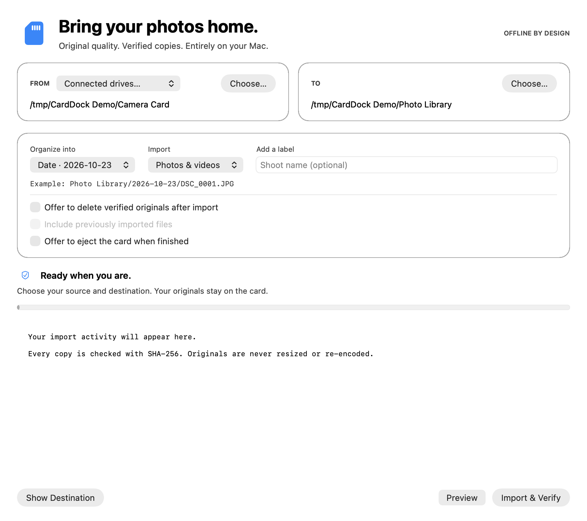

<p align="center">
  
</p>

<p align="center">
  <strong>A small, native Mac app for importing photos with confidence.</strong><br>
  Choose a card. Choose a folder. Keep every original pixel.
</p>

<p align="center">
  <a href="https://github.com/edcadet10/carddock/releases/latest"></a>
  <a href="https://github.com/edcadet10/carddock/actions/workflows/checks.yml"></a>
  <a href="LICENSE"></a>
  
</p>

<p align="center">
  <a href="https://github.com/edcadet10/carddock/releases/latest"><strong>Download for Mac ↗</strong></a>
  &nbsp; · &nbsp; <a href="docs/INSTALL.md">Installation guide</a>
  &nbsp; · &nbsp; <a href="docs/SAFETY.md">How verification works</a>
  &nbsp; · &nbsp; <a href="CONTRIBUTING.md">For developers</a>
</p>

<p align="center"></p>

## Your files. Your folders. Your Mac.

CardDock copies original photos and videos from a card or folder into a library you choose. It checks file contents, organizes by date, and remembers your choices. No account, cloud storage, subscription, telemetry, or network service is used by the app.

| Thoughtful defaults | What you get |
| :--- | :--- |
| **Choose where everything goes** | Source folder and connected-drive selection, a destination picker, and remembered folder bookmarks. |
| **Originals stay original** | JPG, RAW, HEIC, video and supported companion files are copied without resizing or re-encoding. |
| **Verify, then trust** | SHA-256 checks confirm file contents. Same filename and size alone never establish a duplicate. |
| **Make room without overwriting** | Conflicting filenames receive a suffix. Final placement refuses to replace an existing file. |
| **See the plan first** | Preview reads and compares files without writing to the source or destination. |
| **Keep control** | Originals stay on the card by default. Optional deletion requires two confirmations and fresh checks of both copies. |

## Install in a minute

1. Open **[Releases](https://github.com/edcadet10/carddock/releases/latest)** and download the ZIP for your Mac:
   - **Apple Silicon (`arm64`)** — M1, M2, M3, M4 and newer Apple chips.
   - **Intel (`x86_64`)** — Macs with an Intel processor.
2. Unzip and drag **CardDock.app** into **Applications**.
3. Open CardDock. If macOS blocks it, open **System Settings → Privacy & Security → Open Anyway**, then confirm.
4. Choose **From** and **To**, use **Preview** to inspect the plan, then **Import & Verify**.

**No Python or developer tools required.** Python is bundled inside the download. Requires macOS 13 Ventura or newer. Check **Apple menu → About This Mac** if you're unsure which download to choose.

This is a free community project. Downloads are **ad-hoc signed, not Apple-notarized or Developer ID–signed**, so a first-launch security prompt is expected. The installation guide explains Apple's per-app exception; you do not need to disable Gatekeeper globally. Managed Macs may disallow installation. [Full installation help →](docs/INSTALL.md)

## A simple workflow

**Select → Preview → Import & verify → Keep originals → Eject when ready.**

Choose daily folders (`2026-10-23`) or nested folders (`2026/10/23`), optionally add a shoot label, and import photos, videos, or both. A source can be a mounted card or an ordinary media folder. The app reads the selected folder recursively; choose the specific folder you intend to import.

If you enable deletion, the default scope is **files copied in this run**. Including earlier imports is a separate option. Camera-protected files stay protected. Deletion preferences reset when you reopen the app.

## Know the boundaries

- **Early public release:** automated safety tests and local GUI checks are included. This is not a substitute for a separate backup. Start with a spare card or copied test folder.
- **Dates:** embedded capture dates are read from supported JPEG/TIFF-based formats. Other formats, including CR3, RAF, HEIC and many videos, use their filesystem date; the activity log reports the fallback. File-copy support is broader than metadata-date support.
- **RAW support means copying originals**, not developing, converting or rendering RAW previews.
- **Companions:** matching-stem XMP, AAE, WAV, THM, XML and SRT files in the same source folder are included. Complete proprietary camera folder structures and spanned-video reconstruction are not implemented.
- **Recovery:** completed copies remain after a stop. Running again checks them and imports what is missing. An interrupted individual file restarts from the beginning. Files already deleted before a stop cannot be restored by stopping.
- **Storage:** local folders and mounted disks are the intended destinations. Network shares and cloud-managed folders are not validated release targets. A cloud-sync folder chosen by you may upload files through that provider's software.

[Read the safety model and test coverage →](docs/SAFETY.md)

## For developers

The interface is native **Swift/AppKit**. The engine uses **Python's standard library**, SQLite for local import history, and SHA-256 for verification. The two processes communicate over stdin/stdout; there is no local web server.

```sh
# Run safety tests (Python 3.10+)
python3 -m unittest discover -s tests -v

# Preview from the command line
python3 sd_import.py --source "/Volumes/CAMERA" --dest "$HOME/Pictures/Photos" --dry-run

# Build a self-contained app (Mac, command-line tools, Python 3.12+)
./scripts/build.sh arm64
# Or: ./scripts/build.sh x86_64
```

Builds download pinned, checksum-verified CPython archives from Astral's `python-build-standalone` releases. Runtime licenses ship inside the app. Build outputs go to `build/`; release ZIPs go to `dist/`. See [CONTRIBUTING.md](CONTRIBUTING.md), [third-party notices](THIRD_PARTY_NOTICES.md), and the [changelog](CHANGELOG.md).

## Contribute

Found a camera format or disk behavior that needs attention? [Open an issue](https://github.com/edcadet10/carddock/issues/new/choose) with your macOS version, Mac architecture, filesystem and a redacted activity log. Never include private photos or credentials. Reproducible synthetic examples are especially useful.

Released under the [MIT License](LICENSE). Built for people who want a small, understandable photo importer.
